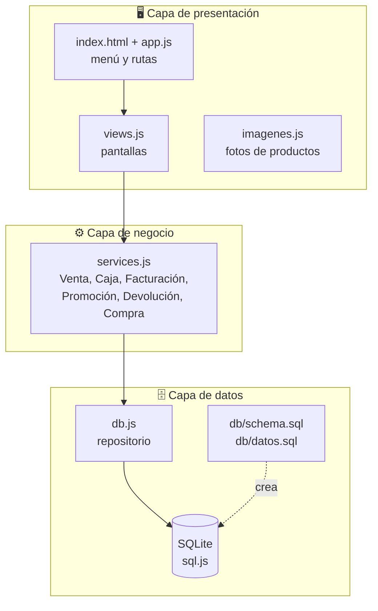
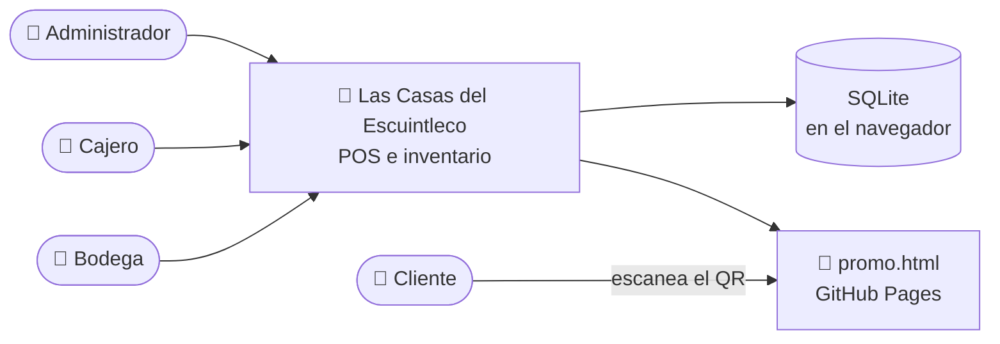
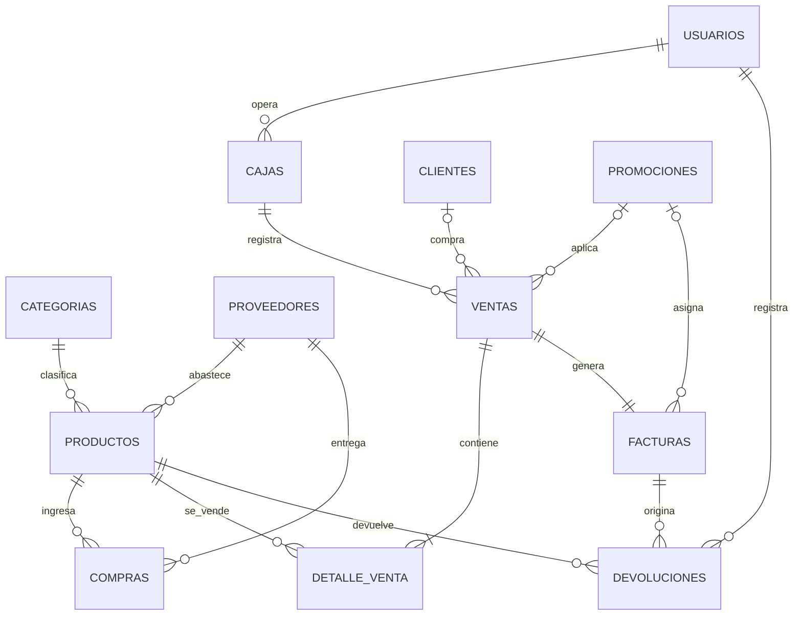
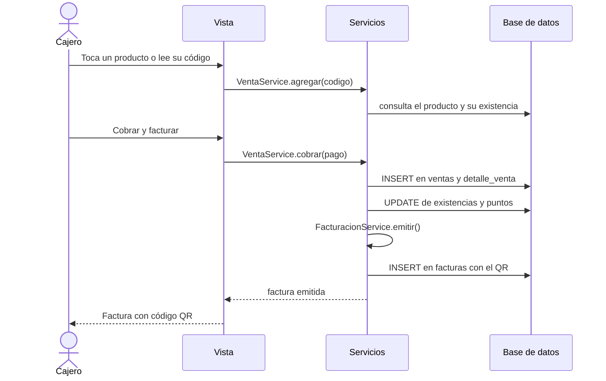

<div align="center">

# 🏘️ Las Casas del Escuintleco

### Sistema web de punto de venta e inventario para productos de consumo masivo


**[🌐 Ver el sistema en línea](https://mmarcos00.github.io/las-casas-escuintleco/)**

</div>

---

## 📑 Contenido

1. [Descripción](#-descripción)
2. [Capturas](#-capturas)
3. [Cumplimiento de los requisitos](#-cumplimiento-de-los-requisitos)
4. [Funcionalidades](#-funcionalidades)
5. [Arquitectura](#-arquitectura)
6. [Base de datos](#-base-de-datos)
7. [Flujo de una venta](#-flujo-de-una-venta)
8. [Códigos QR y promociones](#-códigos-qr-y-promociones)
9. [Usuarios de prueba](#-usuarios-de-prueba)
10. [Tecnologías](#-tecnologías)
11. [Estructura del proyecto](#-estructura-del-proyecto)
12. [Cómo ejecutarlo](#-cómo-ejecutarlo)
13. [Documentación](#-documentación)
14. [Limitaciones](#-limitaciones-conocidas)
15. [Autor](#-autor)

---

## 📖 Descripción

**Las Casas del Escuintleco** es un sistema web para vender productos de consumo masivo a las personas que viven en colonias residenciales. Controla el inventario que ingresa y el que se vende, con el fin de tener claros todos los ingresos y egresos del negocio.

Familias de productos que maneja:

| 🍝 Pastas | 🍗 Cárnicos | 🥓 Embutidos | 🧀 Lácteos | 🍫 Golosinas | 💧 Aguas gaseosas | 🥤 Carbonatados |
|:---:|:---:|:---:|:---:|:---:|:---:|:---:|

El sistema funciona completamente en el navegador, es **gratuito**, usa **software libre** y se adapta a **computadora y celular**.

---

## 📸 Capturas

| Inicio de sesión | Panel de inicio |
|:---:|:---:|
|  |  |

| Punto de venta | Factura con QR |
|:---:|:---:|
|  |  |

| Base de datos | Versión celular |
|:---:|:---:|
|  |  |

---

## ✅ Cumplimiento de los requisitos

Relación entre lo que pide el documento del proyecto y lo que se implementó:

| # | Requisito del proyecto | Dónde está en el sistema |
|:-:|---|---|
| 1 | **Interface de acceso** a nivel de base de datos | Login con usuarios, roles y contraseñas cifradas (SHA-256) guardados en la tabla `usuarios` |
| 2 | **Catálogos**: clientes, proveedores, productos y precios | Menú *Ventas → Clientes*, *Compras → Proveedores*, *Almacén → Productos y precios* |
| 3 | **Despacho de producto**: lectura por línea, cobro, subtotales y total | *Punto de Venta → Despacho de producto* |
| 4 | **Devoluciones** por daño o vencimiento | *Punto de Venta → Devoluciones* |
| 5 | **Cobro** con tarjeta de crédito, débito o efectivo | Panel de cobro del punto de venta, con cálculo de cambio |
| 6 | **Facturación** con datos del cliente y todos los productos | Factura con NIT, autorización, detalle y total en letras |
| 7 | **Reportes**: corte de caja, devoluciones, clientes y compras | Menú *Informes* (con exportación a Excel e impresión a PDF) |
| 8 | **Código QR** en la factura que indica la promoción | QR en cada factura que abre la página `promo.html` |
| 9 | **Menú interactivo** como en el ejemplo | Encabezado morado: Mensajería, Ventas, Punto de Venta, Contabilidad, Compras, Almacén… |
| 10 | **Apertura de caja** (monto inicial y de cierre) | *Punto de Venta → Apertura / cierre de caja*, con arqueo de billetes |
| 10.a | **Descuentos por QR**: producto gratuito, vale de regalo, 2.º a mitad de precio, mayoreo y puntos | *Punto de Venta → Leer código QR* |
| — | Base de datos **relacional** | SQLite con 12 tablas, llaves foráneas, restricciones y vistas |
| — | Modelo de **3 capas / MVC** | Presentación, negocio y datos en carpetas separadas |
| — | **C4, DDD, Hexagonal y Kanban** | Ver la sección de [documentación](#-documentación) |

---

## 🚀 Funcionalidades

**Ventas**
- Despacho con tarjetas de producto con **foto real**, buscador y lector de código de barras con la cámara.
- Subtotales por línea, descuentos, total y botones rápidos de efectivo.
- Pago en efectivo, débito o crédito, con validación de monto y de tarjeta.
- Clientes con **puntos acumulables** que se pueden usar como descuento.

**Facturación**
- Factura con NIT, autorización, código de control y total en letras (por ejemplo: *CUARENTA Y UN CON 50/100 QUETZALES*).
- Código QR, impresión a PDF y envío por WhatsApp.

**Control del negocio**
- Caja con apertura, arqueo de billetes y monedas, y corte con diferencia.
- Inventario con alertas de **stock bajo** y **productos por vencer**.
- Compras a proveedores que aumentan las existencias.
- Devoluciones por daño o vencimiento.

**Administración**
- Roles con permisos: **Administrador**, **Cajero** y **Bodega**.
- Panel de inicio con gráficas: ventas de 7 días, ventas por familia y productos más vendidos.
- Buscador global (`Ctrl + K`), modo oscuro y exportación a Excel (CSV).
- Pantalla **Base de datos** con tablas, columnas, relaciones y consola SQL de solo lectura.
- Respaldo y restauración de la base completa en un archivo `.db`.

**Experiencia de uso**
- Diseño responsivo: detecta el celular y cambia a barra inferior, menú lateral y tablas en forma de tarjetas.
- Validaciones con mensajes claros (por ejemplo, distingue "el usuario no existe" de "la contraseña es incorrecta").
- Atajos: `F2` busca producto, `F9` cobra, `Ctrl + K` busca en todo el sistema.

---

## 🏛️ Arquitectura

El sistema sigue el **modelo de 3 capas (MVC)**. Cada capa solo depende de la que está debajo, lo que permite cambiar la base de datos o las pantallas sin romper las reglas del negocio.



Los servicios funcionan como los **casos de uso** del sistema y la base de datos como el **puerto de salida**, siguiendo la idea de arquitectura hexagonal y DDD.

| Capa | Archivo | Responsabilidad |
|---|---|---|
| Presentación | `js/presentation/app.js` | Menú, rutas, permisos, tema y detección de dispositivo |
| Presentación | `js/presentation/views.js` | Pantallas, formularios y validaciones |
| Presentación | `js/presentation/imagenes.js` | Fotos reales de productos (API de Wikipedia) |
| Negocio | `js/business/services.js` | Reglas: ventas, promociones, caja, facturas, devoluciones y compras |
| Datos | `js/data/db.js` | Acceso a SQLite, transacciones y persistencia |
| Datos | `db/schema.sql` / `db/datos.sql` | Estructura de la base y datos iniciales |

### Contexto del sistema (Modelo C4, nivel 1)



---

## 🗄️ Base de datos

Base de datos **relacional SQLite** con **12 tablas**, llaves primarias y foráneas, restricciones `CHECK` y `UNIQUE`, índices y 2 vistas. Corre dentro del navegador con `sql.js` y se guarda automáticamente.



| Tabla | Contenido |
|---|---|
| `usuarios` | Acceso, rol y contraseña cifrada |
| `categorias` | Las 7 familias de producto |
| `proveedores` | Proveedores del negocio |
| `clientes` | Clientes, NIT y puntos |
| `productos` | Catálogo, precios, mayoreo, existencia y vencimiento |
| `promociones` | Gratis, vale, 2.º a mitad, mayoreo y puntos |
| `cajas` | Apertura y cierre con diferencia |
| `ventas` | Encabezado de cada venta y forma de pago |
| `detalle_venta` | Líneas de cada venta |
| `facturas` | Factura, autorización, QR y estado de canje |
| `devoluciones` | Devoluciones por daño o vencimiento |
| `compras` | Ingreso de mercadería |

**Vistas:** `v_ventas_por_producto` y `v_stock_bajo`.

**Integridad:** las llaves foráneas impiden, por ejemplo, borrar un producto que ya se vendió.

Para ver la base de datos fuera del sistema, abre `db/schema.sql` y `db/datos.sql` en WebStorm o DataGrip (SQLite), o descarga el archivo `.db` desde **Más → Base de datos → Descargar .db**.

---

## 🔄 Flujo de una venta



---

## 🎁 Códigos QR y promociones

Cada factura incluye un **código QR** con la dirección de la página `promo.html`. Al escanearlo con el celular se abre una página que muestra la promoción que la factura le otorga al cliente para su próxima compra.

| Tipo | Descripción |
|---|---|
| 🎁 **Producto gratuito** | Se agrega sin costo un producto a la compra |
| 🎟️ **Vale de regalo** | Descuento de un monto fijo en quetzales |
| ➗ **Segundo a mitad de precio** | La segunda unidad de un producto cuesta la mitad |
| 📦 **Compra por mayoreo** | Con 3 o más productos de la misma familia se aplica el precio de mayoreo |
| ⭐ **Puntos por producto** | El cliente acumula puntos para pagar en su próxima compra |

**Cómo se canjea:** en *Punto de Venta → Leer código QR* se escanea el QR (con la cámara) o se pega su enlace, y la promoción se aplica a la venta actual. Cada código solo se puede canjear **una vez** y tiene fecha de vencimiento.

---

## 🔑 Usuarios de prueba

| Rol | Usuario | Contraseña | Puede usar |
|---|---|---|---|
| **Administrador** | `admin` | `admin123` | Todo el sistema |
| **Cajero** | `cajero` | `cajero123` | Caja, despacho, devoluciones, QR, facturas e inventario |
| **Bodega** | `bodega` | `bodega123` | Compras, proveedores, productos e inventario |

> En el inicio de sesión hay botones de acceso rápido para estos tres usuarios.

---

## 🛠️ Tecnologías

Todo el software es **libre y gratuito**, sin claves ni servicios de pago.

| Tecnología | Uso |
|---|---|
| HTML5, CSS3 y JavaScript (módulos ES) | Estructura, estilos y lógica |
| [Bootstrap 5.3](https://getbootstrap.com/) y [Bootstrap Icons](https://icons.getbootstrap.com/) | Diseño y íconos |
| [sql.js](https://sql.js.org/) (SQLite en WebAssembly) | Base de datos relacional |
| [qrcodejs](https://github.com/davidshimjs/qrcodejs) | Generación de códigos QR |
| [html5-qrcode](https://github.com/mebjas/html5-qrcode) | Lectura de QR y códigos de barras con la cámara |
| [API de Wikipedia](https://www.mediawiki.org/wiki/API:Main_page) | Fotos reales de los productos |
| [Google Fonts (Nunito)](https://fonts.google.com/specimen/Nunito) | Tipografía |
| GitHub Pages | Alojamiento gratuito |

---

## 📂 Estructura del proyecto

```
las-casas-escuintleco/
├── index.html                 # Punto de entrada
├── promo.html                 # Página que abre el QR de la factura
├── manifest.json              # Permite instalarlo como acceso directo en el celular
├── icon.svg
├── css/
│   └── style.css              # Estilos, tema claro/oscuro y diseño responsivo
├── db/
│   ├── schema.sql             # Estructura de la base de datos
│   └── datos.sql              # Datos iniciales
├── js/
│   ├── data/
│   │   └── db.js              # Capa de datos (SQLite)
│   ├── business/
│   │   └── services.js        # Capa de negocio
│   └── presentation/
│       ├── app.js             # Menú, rutas y permisos
│       ├── views.js           # Pantallas
│       └── imagenes.js        # Fotos de productos
└── docs/                      # Documentación y capturas
```

---

## ▶️ Cómo ejecutarlo

### Opción 1: en línea
Abre **https://mmarcos00.github.io/las-casas-escuintleco/** e inicia sesión con alguno de los [usuarios de prueba](#-usuarios-de-prueba). La primera vez necesita internet para descargar las librerías.

### Opción 2: en tu computadora con WebStorm
1. Clona el repositorio:
```bash
   git clone https://github.com/MMarcos00/las-casas-escuintleco.git
```
2. Ábrelo en WebStorm.
3. Clic derecho sobre `index.html` → **Open in → Browser**.

> El proyecto usa módulos ES, por lo que **no funciona abriendo el archivo con doble clic**; necesita un servidor, como el integrado de WebStorm.

### Opción 3: con cualquier servidor local
```bash
npx serve .
# o con Python:
python -m http.server 8000
```
Luego abre `http://localhost:3000` (o `:8000`).

### Probar el sistema paso a paso
1. Entra como `cajero` y abre la caja con **Q200**.
2. Vende algunos productos y cobra en efectivo. Se genera la factura con su QR.
3. Escanea el QR con tu celular para ver la promoción.
4. En *Leer código QR* pega el enlace del código para aplicarlo en una nueva venta.
5. Haz una devolución y cierra la caja con el arqueo.
6. Entra como `admin` y revisa los reportes y la pantalla **Base de datos**.

---

## 📚 Documentación

| Documento | Descripción |
|---|---|
| [Modelo C4](docs/Modelo_C4_Las_Casas_del_Escuintleco.drawio) | Diagramas de contexto, contenedores, componentes y código |
| [Arquitectura hexagonal](docs/Arquitectura_Hexagonal_Las_Casas_del_Escuintleco.drawio) | Puertos y adaptadores del sistema |
| [Esquema de la base de datos](db/schema.sql) | Tablas, llaves foráneas, restricciones y vistas |

Los archivos `.drawio` se abren en [app.diagrams.net](https://app.diagrams.net/).

---

## ⚠️ Limitaciones conocidas

- Los datos se guardan **en el navegador** de cada equipo. Para llevarlos a otro equipo se usa *Más → Respaldo de datos*.
- La factura es **de demostración** y no es una factura electrónica válida ante la SAT.
- El control de "código QR ya canjeado" se hace en la caja donde se emitió la factura; la página de la promoción solo muestra la información.
- Las contraseñas se guardan con SHA-256 para fines académicos. En un sistema real se usaría un servidor con cifrado con sal.
- Las fotos de los productos y las librerías necesitan conexión a internet la primera vez.

---

## 👨‍💻 Autor

<div align="center">

**Marcos Emanuel Méndez Ortega**

Carné: **0905-23-5324**

Curso: **Desarrollo Web**

Proyecto individual · 2026

[](https://github.com/MMarcos00)

</div>

---

<div align="center">

Hecho con 💜 para la clase de Desarrollo Web

</div>